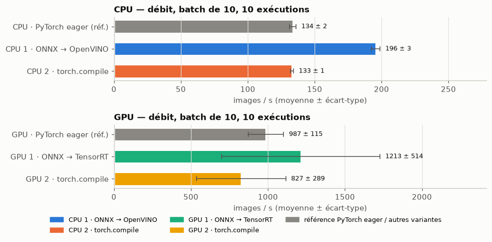
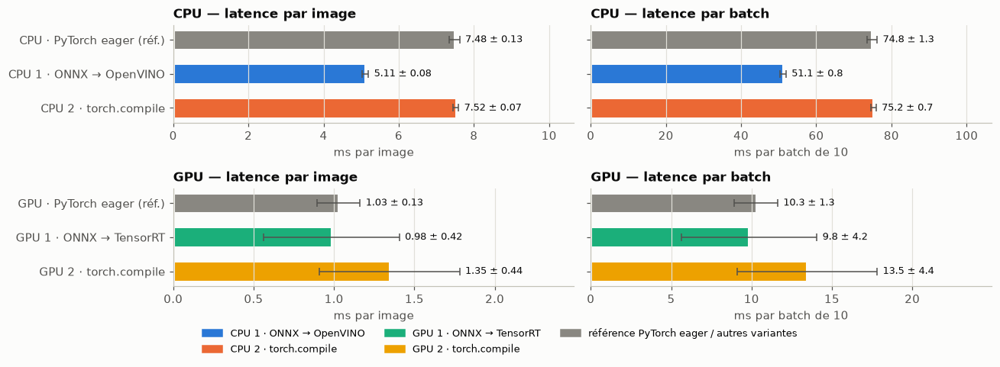
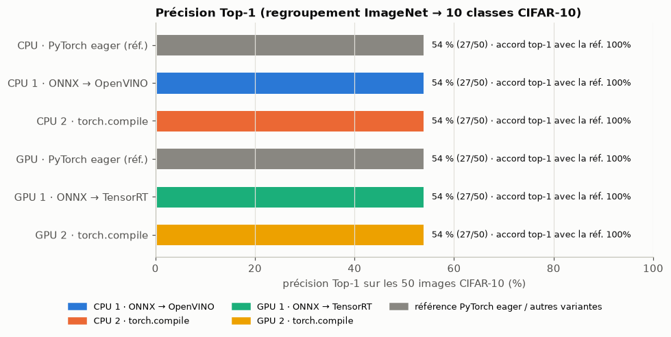
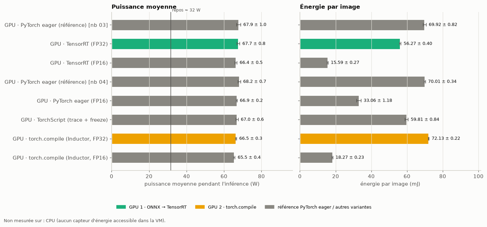
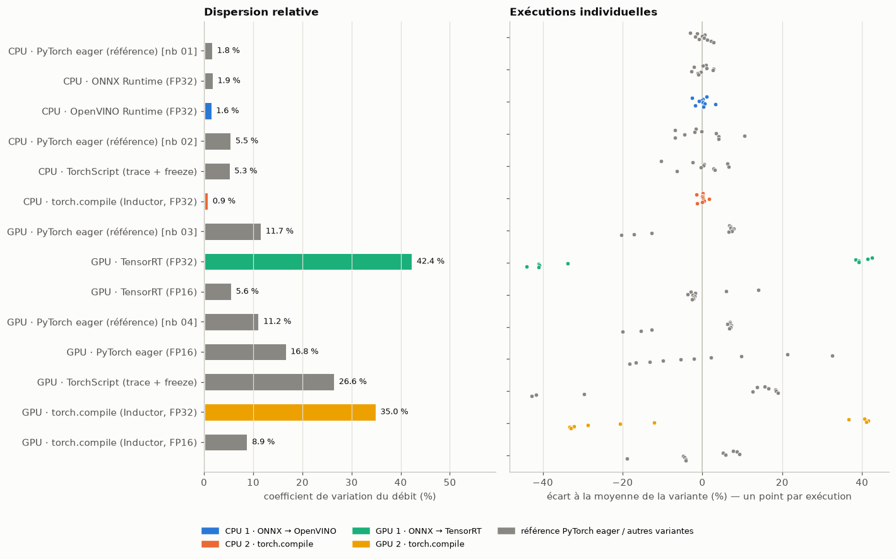
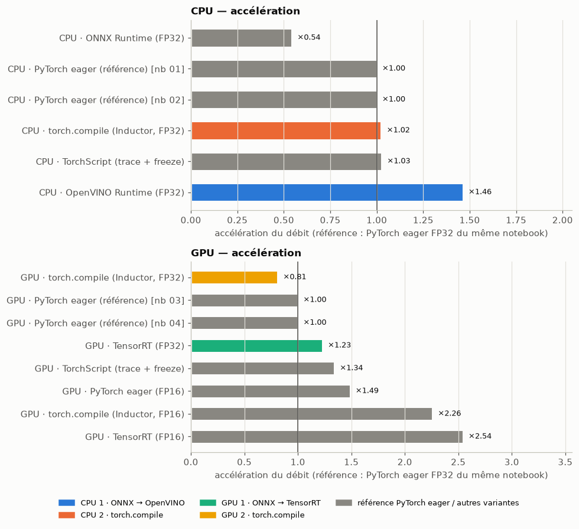

# TP Déploiement IA — Analyse comparative de pipelines d'inférence (CPU / GPU)

**EIGSI Casablanca — Filière IABD — Module Déploiement IA — novembre 2026**
Réalisé par : Chiara Mégane BEDOUME LEGNIGHA

Ce dépôt compare **quatre chaînes de déploiement** d'un même modèle PyTorch pré-entraîné (ResNet-18 ImageNet), deux sur CPU et deux sur GPU, en suivant l'enchaînement des couches vu en cours :

> Haut niveau → Format du modèle → Middle level → Bas niveau → Matériel

Pour chaque pipeline : débit (images/s), temps d'inférence, précision Top-1, cohérence des prédictions avec PyTorch, consommation énergétique (GPU) et stabilité des mesures sur 10 exécutions (moyenne, écart-type, minimum, maximum).

📄 **Rapport technique : [`rapport/Rapport_TP_Deploiement_IA.pdf`](rapport/Rapport_TP_Deploiement_IA.pdf)**

## Les quatre pipelines

| | Haut niveau | Format du modèle | Middle level | Bas niveau | Matériel | Notebook |
|---|---|---|---|---|---|---|
| **CPU 1** | PyTorch | ONNX | OpenVINO Runtime | kernels CPU (Arm Compute Library sur ARM, oneDNN sur x86) | CPU | [`01_CPU_PyTorch_ONNX_OpenVINO`](notebooks/01_CPU_PyTorch_ONNX_OpenVINO.ipynb) |
| **CPU 2** | PyTorch | graphe FX (TorchDynamo) / TorchScript | torch.compile (Inductor) | kernels C++ générés + ATen | CPU | [`02_CPU_PyTorch_TorchScript_TorchCompile`](notebooks/02_CPU_PyTorch_TorchScript_TorchCompile.ipynb) |
| **GPU 1** | PyTorch | ONNX | TensorRT | CUDA / cuDNN / cuBLAS | GPU Tesla T4 (Colab) | [`03_GPU_PyTorch_ONNX_TensorRT`](notebooks/03_GPU_PyTorch_ONNX_TensorRT.ipynb) |
| **GPU 2** | PyTorch | graphe FX (TorchDynamo) / TorchScript | torch.compile (Inductor) | kernels Triton + cuDNN / cuBLAS | GPU Tesla T4 (Colab) | [`04_GPU_PyTorch_TorchCompile_TorchScript`](notebooks/04_GPU_PyTorch_TorchCompile_TorchScript.ipynb) |

Chaque notebook mesure aussi **PyTorch eager FP32 sur le même matériel** (référence) et des variantes qui aident à interpréter les écarts : ONNX Runtime (même ONNX, autre runtime), TorchScript, PyTorch FP16, TensorRT FP16, torch.compile FP16.

Le notebook [`05_Comparaison_des_pipelines`](notebooks/05_Comparaison_des_pipelines.ipynb) rassemble les résultats, vérifie que les conditions expérimentales sont identiques et produit les tableaux et graphiques.

## Organisation du dépôt

```
├── README.md
├── requirements.txt          # dépendances pour une exécution locale
├── notebooks/                # 4 notebooks de pipelines + notebook de comparaison, exécutés (avec sorties)
├── results/                  # mesures brutes (JSON), sorties du modèle (NPZ), tableaux récapitulatifs
├── figures/                  # graphiques produits par les notebooks
└── rapport/                  # rapport technique (PDF)
```

## Protocole expérimental

- **Données** : 50 images du jeu de test CIFAR-10, les 5 premières de chaque classe (sous-ensemble équilibré et déterministe). Des empreintes SHA-256 des images, du tenseur prétraité et des poids vérifient que les 4 pipelines ont traité exactement les mêmes entrées.
- **Prétraitement** : 32×32 → 224×224 (bilinéaire), normalisation ImageNet (moyenne 0,485 / 0,456 / 0,406, écart-type 0,229 / 0,224 / 0,225).
- **Modèle** : `torchvision.models.resnet18`, poids `IMAGENET1K_V1`, sans réentraînement.
- **Précision Top-1 sur 10 classes** : les 1000 classes ImageNet sont regroupées en 10 super-classes CIFAR-10 (somme des probabilités softmax du groupe).
- **Mesures** : batch de 10, 10 batchs de chauffe, puis 10 exécutions chronométrées du passage complet sur les 50 images ; chaque batch est chronométré avec synchronisation du GPU, les données étant déjà en mémoire du device.
- **Énergie** : NVML sur GPU (énergie de la carte), 3 fenêtres d'au moins 5 s par variante. Sur CPU, aucun capteur n'était accessible.

## Exécution

Sur Google Colab : *Fichier > Ouvrir un notebook > GitHub*, coller l'URL de ce dépôt et choisir le notebook.

1. Notebooks 01 et 02 sur un environnement **CPU**, 03 et 04 sur un **GPU T4** (*Exécution > Modifier le type d'exécution*), puis *Exécution > Tout exécuter*.
2. Chaque notebook télécharge une archive `<pipeline>_sorties.zip` (`results/` et `figures/`) à décompresser à la racine du dépôt.
3. Exécuter le notebook 05 : il produit `figures/fig1` à `fig9`, `results/tableau_recapitulatif.md`, `results/tableau_complet.csv` et `results/predictions_par_image.csv`.

En local : `pip install -r requirements.txt` (TensorRT : `pip install tensorrt-cu12`, GPU NVIDIA uniquement), puis `jupyter lab notebooks/`.

## Résultats

### Pipelines étudiés (FP32)

| Pipeline | Débit (img/s) | Latence (ms/image) | CV du débit | vs PyTorch | Énergie (mJ/image) | Préparation |
|---|---|---|---|---|---|---|
| CPU · PyTorch eager (référence) | 133,7 ± 2,4 | 7,48 | 1,8 % | ×1,00 | n/d | — |
| CPU 1 · ONNX → OpenVINO | 195,7 ± 3,1 | 5,11 | 1,6 % | ×1,46 | n/d | 4,0 s |
| CPU 2 · torch.compile | 133,0 ± 1,2 | 7,52 | 0,9 % | ×1,02 | n/d | 12,5 s |
| GPU · PyTorch eager (référence) | 986,7 ± 115,3 | 1,03 | 11,7 % | ×1,00 | 69,9 | — |
| GPU 1 · ONNX → TensorRT | 1 213,5 ± 514,4 | 0,98 | 42,4 % | ×1,23 | 56,3 | 12,8 s |
| GPU 2 · torch.compile | 826,6 ± 289,4 | 1,35 | 35,0 % | ×0,81 | 72,1 | 16,8 s |

Moyenne ± écart-type sur 10 exécutions de 50 images, batch de 10. Accélération par rapport à PyTorch mesuré dans le même notebook.

### GPU en régime continu (fenêtres de 5 s, dispersion < 4 %)

| Variante (Tesla T4) | Débit continu (img/s) | vs PyTorch | Énergie (mJ/image) |
|---|---|---|---|
| PyTorch eager FP32 | 971 / 974 (2 sessions) | ×1,00 | 69,9 / 70,0 |
| torch.compile FP32 | 922 | ×0,95 | 72,1 |
| TorchScript FP32 | 1 121 | ×1,15 | 59,8 |
| TensorRT FP32 | 1 203 | ×1,24 | 56,3 |
| PyTorch eager FP16 | 2 024 | ×2,08 | 33,1 |
| torch.compile FP16 | 3 584 | ×3,68 | 18,3 |
| TensorRT FP16 | 4 263 | ×4,39 | 15,6 |

**Qualité** : les 50 images reçoivent la même prédiction dans toutes les variantes, FP16 compris ; Top-1 = 54 % (27/50) partout. Écart maximal des logits : 2·10⁻⁵ à 6·10⁻⁵ en FP32, 3·10⁻² à 9·10⁻² en FP16.

| Débit | Latence |
|---|---|
|  |  |
| **Précision Top-1** | **Énergie (GPU)** |
|  |  |
| **Variabilité** | **Accélération vs PyTorch eager** |
|  |  |

## Principales conclusions

- **Le middle level compte quand il change la façon de calculer les convolutions.** OpenVINO (×1,46 sur CPU) et TensorRT (×1,24 en FP32 sur GPU) fusionnent les opérateurs et choisissent des kernels adaptés au matériel (convolutions Winograd). torch.compile fusionne surtout les opérations autour des convolutions et n'apporte rien de mesurable sur ResNet-18 en FP32.
- **Le runtime compte plus que le format.** Le même fichier ONNX tourne 2,7 fois plus vite avec OpenVINO qu'avec ONNX Runtime.
- **Le levier le plus fort est le FP16 combiné à un compilateur.** Sur le T4, le FP16 seul double le débit ; un compilateur le multiplie encore par 1,8 à 2,1 (TensorRT FP16 : ×4,39 en régime continu), sans changer aucune prédiction.
- **Accélérer, c'est économiser l'énergie.** Le T4 tire 65 à 68 W quelle que soit la variante : l'énergie par image baisse avec la vitesse, de 69,9 mJ (PyTorch) à 15,6 mJ (TensorRT FP16).
- **Les mesures GPU FP32 changent de régime en cours de série** (CV jusqu'à 42 %), au même moment dans les deux sessions. L'hypothèse la plus probable est une baisse de fréquence de la carte, à sa limite de puissance de 70 W. Les mesures continues de 5 s sont la comparaison la plus fiable.

## Limites

- Les notebooks CPU (01, 02) ont été exécutés sur un MacBook Pro M3 Pro (ARM, 12 cœurs) et non sur le CPU de Colab : OpenVINO y utilise Arm Compute Library au lieu de oneDNN, et les résultats CPU valent pour cette machine.
- 50 images : une image représente 2 points de précision ; le Top-1 de 54 % est limité par le protocole (images 32×32 agrandies, regroupement des classes), pas par les pipelines.
- Énergie mesurée pour la carte graphique seule ; aucune mesure sur CPU.
